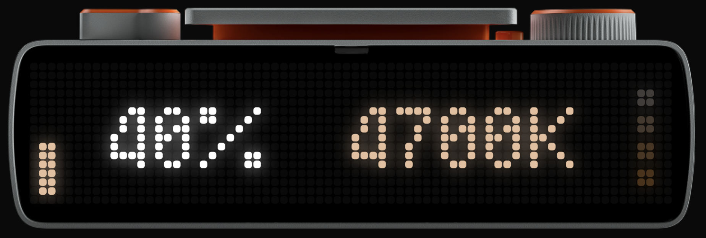

# Key Light Remote

Control your Elgato Key Light from your BUSY Bar: turn it on and off, set brightness and color temperature with
the wheel, and switch between four presets. The app runs on the BUSY Bar itself and talks to the light over your
network. Changing the light currently needs a small relay running on a computer on your network (a BUSY Bar firmware
limitation — see [Setup](#setup)); seeing its status does not.

> [!NOTE]
> So far the app has only run on the BUSY Bar Emulator, the BUSY Bar's firmware running on a computer, never on a
> real BUSY Bar. Against a real Key Light Air it works from there. If you try it on a real BUSY Bar, please open an
> issue and say how it went.



## Features

- **Power** with the Start/Pause button.
- **Brightness and color temperature** on the wheel, from 1 % to 100 % and from 2900 K to 7000 K.
- **Four presets** you define yourself, one turn of the wheel away.
- **Stays in sync** with Elgato Control Center: changes made there show up within a few seconds.
- **Status at a glance** on the back display: the light's name, address, firmware and connection.

## Setup

1. **Give the light a fixed IP address.** Look up the light's address in Elgato Control Center or your router, and
   reserve it in your router (a DHCP reservation), so it doesn't change. The BUSY Bar can't look up `.local` names, so
   the app needs the number.
2. **Install the app** on your BUSY Bar: [build it from source](#building-from-source), or take
   `me.arne.keylight-<version>.tgz` from a release and [install that](#installing-a-release).
3. **Run the relay.** To change the light, start `tools/http11-relay.mjs` on a computer on your network, pointed at the
   light: `node tools/http11-relay.mjs --light 192.168.1.20`. It re-sends the app's requests to the light over
   HTTP/1.1, because the BUSY Bar sends HTTP/1.0 and a Key Light rejects changes over it
   ([details](#changing-the-light-needs-a-relay)). The relay is one file and needs only Node 20 or newer, nothing
   installed. The light can only be changed while it runs, so put it on a computer that stays on, and give that
   computer a fixed IP address too. Skip this if you only want to see the light's status.
4. **Enter the address.** Open your BUSY Bar's web interface (its IP address in a browser), go to the app's settings
   and set **Key Light IP address** to the computer running the relay, e.g. `192.168.1.50`. (Without a relay, point it
   at the light itself, e.g. `192.168.1.20` — status only.) Add a port only if you changed it from 9123.
5. **Start the app** from APPS on your BUSY Bar.

The BUSY Bar and the light have to be on the same network. Key Lights only connect to 2.4 GHz Wi-Fi.

The app controls one light: the one at the address in its settings.

## Using it

| Control | What it does |
| --- | --- |
| **Start/Pause** | Turns the light on or off |
| **Wheel press** | Selects brightness, color temperature or the presets, in turn. The selection is outlined for 4 seconds |
| **Wheel turn** | Changes the selection: 1 % or 50 K per click, 5 % or 200 K when you turn fast. On the presets, steps through them |
| **Back** | Leaves the app |

The wheel always works on what you last changed. Pressing it only to look around doesn't stick: when the outline
disappears, the wheel goes back to the value you last changed. After the app starts, it changes the brightness.

### The front display

- **Left:** a bar that grows with the brightness, in the color of the light. It turns red while the light doesn't
  answer.
- **Middle:** the brightness and the color temperature, tinted in the light's color. Both are dimmed while the light
  is off.
- **Right:** the four presets as small squares, each in its color. The one matching the light is lit.

### The back display

The light's name (or its model, if you haven't named it in Control Center), its IP address, firmware version and
connection status. When something goes wrong, the full error is shown below.

## Presets

Turn to the presets with the wheel button and step through them by turning. Picking a preset sets its brightness and
color temperature and turns the light on. As soon as you change a value by hand, here or in Control Center, no preset
is active and all four squares are dimmed. The active preset is the one whose values the light has, so set the light
to a preset's values by hand and that preset lights up.

Set the presets in the app's settings:

| Setting | Default |
| --- | --- |
| **Show presets** | On. Turn it off to hide the column; the values then use the full width |
| **Preset 1 Brightness** / **Preset 1 Temperature** | 100 % / 5600 K |
| **Preset 2 Brightness** / **Preset 2 Temperature** | 70 % / 4500 K |
| **Preset 3 Brightness** / **Preset 3 Temperature** | 40 % / 3500 K |
| **Preset 4 Brightness** / **Preset 4 Temperature** | 15 % / 2900 K |

The app can read its settings but not change them, so presets are set in the settings, not on the bar.

## Troubleshooting

| You see | What to do |
| --- | --- |
| **Set light IP** | No address is set yet, or the one that is set isn't an IP address (the back display says which). A `.local` name doesn't work. Enter the address in the app's settings, see [Setup](#setup). |
| **No settings** | The app couldn't read its settings from the BUSY Bar. It tries again by itself; if it stays, restart the app. |
| **Connecting** for a while | The app is waiting for the light's first answer, which can take up to 5 seconds. |
| **No light**, or a red bar | The light doesn't answer. Check that it's powered and on the network, and that the address in the settings is still right. The back display shows the exact error. |
| *Inactivity timeout* on the back | Nothing answered at that address. The light may have a new address, or it's on another network. |
| *socket error* on the back | The connection was refused or dropped. Check the address and port. With a relay: check that it's running. |
| A value jumps back, *Last change failed: HTTP 400* on the back | The light refused the change because it came straight from the BUSY Bar. Run the relay and point the app at it, see [Changing the light needs a relay](#changing-the-light-needs-a-relay). |
| *HTTP 502* on the back | The relay runs but can't reach the light. Check the address after `--light` and that the light is powered. |

While the light doesn't answer, the app tries again less often, up to every 30 seconds, and picks up as soon as it's
back.

## Compatibility

Tested with a real Elgato **Key Light Air** (firmware 1.0.3). The **Key Light** and **Key Light Mini** share the same
local API for power, brightness and color temperature and should work as well, but nobody has tried them yet.

On the BUSY Bar's side the app has only run on the BUSY Bar Emulator (firmware 1.3.1), against that Key Light Air and
against a simulated light, the one in [Testing without a light](#testing-without-a-light). It has not run on a real
BUSY Bar yet.

### Changing the light needs a relay

A real Key Light Air rejects a change (`PUT`) sent over HTTP/1.0 with `400 Bad Request`, and the BUSY Bar (and the
emulator) always sends HTTP/1.0. Reads (`GET`) are fine, so the app shows the light but can't change it on its own.

The app can't work around this itself: the firmware percent-encodes anything unusual in the URL, so a crafted request
target can't smuggle the version past it (verified by compiling the firmware's own `url.c` and by the light returning
400 for the resulting bytes). The proper fix is for the firmware to send HTTP/1.1
([busybar-firmware#1125](https://github.com/busy-app/busybar-firmware/issues/1125)).

Until then, put `tools/http11-relay.mjs` between the app and the light. It takes the app's requests and re-sends each
to the light over HTTP/1.1, so changes work — from a real BUSY Bar or the emulator.

```sh
node tools/http11-relay.mjs --light 192.168.1.20    # relay on :9123 -> light at 192.168.1.20
busy-emulator allow-local 9123                      # with the emulator: let the app reach the relay
```

Then set the app's **Key Light IP address** to the address where the relay listens (that computer's LAN IP). With the
emulator, the relay can run on the same computer.

The relay only passes requests on to the one light it was started with. Like the light itself, it has no password:
anyone on your network who can reach it can change the light. It listens on all of the computer's network interfaces;
`--host <address>` narrows that down.

To keep it running, start it with whatever your system uses for services: a launchd agent on macOS, a systemd unit on
Linux, or a process manager such as pm2.

## Installing a release

Each [release](../../releases) has the built app attached as `me.arne.keylight-<version>.tgz`. Install it with
[busy-cli](https://www.npmjs.com/package/@busy-app/cli), which needs Node:

```sh
npx @busy-app/cli app install me.arne.keylight-0.1.0.tgz                    # a BUSY Bar connected over USB
npx @busy-app/cli app install me.arne.keylight-0.1.0.tgz --addr <bar-ip>    # or over Wi-Fi
```

Over Wi-Fi the BUSY Bar's HTTP API has to be on (in its web interface); add `--password <password>` if you set one.

## Building from source

You need Node 24 (the version in `.nvmrc`; Node 26 doesn't build).

```sh
npm install
npm run build                             # builds dist/me.arne.keylight.tgz
npm run app:install                       # installs it on a BUSY Bar connected over USB
npm run app:install -- --addr <bar-ip>    # or over Wi-Fi (add --password <password> if set)
npm run app:run                           # starts it
```

`npm run typecheck` checks the types and `npm test` runs the unit tests in `test/`. The code is in `src/`: `main.ts`
runs the app, `elgato.ts` talks to the light, `view.ts` draws both displays and `presets.ts` reads the presets.

The app can also be developed without a BUSY Bar, on the BUSY Bar Emulator, which runs the BUSY Bar's firmware on your
computer; the `busy-emulator` commands in this file and in [AGENTS.md](AGENTS.md) are its command line.

## Testing without a light

`tools/fake-light.mjs` is a fake Key Light, posing as a Key Light Air. It answers like a real one and can be told to
misbehave while it runs. It needs only Node. Like the relay it listens on all network interfaces, so stop it when
you're done.

```sh
npm run fake-light    # the light on port 9123, its control port on 127.0.0.1:9124
```

Set the app's **Key Light IP address** to your computer's address on the network, not `127.0.0.1`, which is the BUSY
Bar itself. With the BUSY Bar Emulator, allow the port first: `busy-emulator allow-local 9123`.

Then type commands into the fake's terminal, or send them from a script:

```sh
curl -d 'set on=0 kelvin=3200' localhost:9124    # change the light as Control Center would
curl -d 'fault hang' localhost:9124              # accept requests, never answer
curl -d 'clear' localhost:9124                   # back to normal
```

| Command | Effect |
| --- | --- |
| `set on=… brightness=… kelvin=…`, `toggle` | Changes the light from outside the app |
| `fault reset` | Closes the connection without answering |
| `fault hang` | Never answers; the BUSY Bar gives up after 5 seconds |
| `fault http <status>` | Answers with that HTTP status |
| `fault garbage` | Answers with a body that isn't JSON |
| `fault bad-shape` | Answers with JSON in the wrong shape |
| `fault ignore-writes` | Accepts changes without applying them |
| `latency <ms>` | Answers every request that much later |
| `offline` / `online` | Refuses connections / accepts them again |
| `clear`, `status`, `help` | |

A fault takes `only=get|put`, `times=<n>` (the next n requests, then it recovers) and `rate=<0..1>` (that share of
requests). `--help` lists the start options, e.g. `--name` and `--port`. By default the fake accepts HTTP/1.0 so the
emulator can change it; `--reject-http10` makes it refuse HTTP/1.0 PUTs like a real Key Light Air, so you can test the
relay (see [Changing the light needs a relay](#changing-the-light-needs-a-relay)).

## CI and releases

CI runs on [Depot CI](https://depot.dev/docs/ci/overview), with the workflows in `.depot/workflows/`: every pull
request and push to `main` is typechecked, tested and built. Pushing a tag that matches the `version` in
`src/appmeta/manifest.json` (e.g. `0.1.0`) attaches `me.arne.keylight-<version>.tgz` to a GitHub release. If Depot
CI's token can't create releases, add a GitHub token with `contents: write` as the Depot CI secret `RELEASE_TOKEN`.

## License

[MIT](LICENSE)

## Trademarks

Not affiliated with, endorsed by, or sponsored by Elgato or Corsair. "Elgato" and "Key Light" are trademarks of their
respective owners, used here only to describe compatibility.
